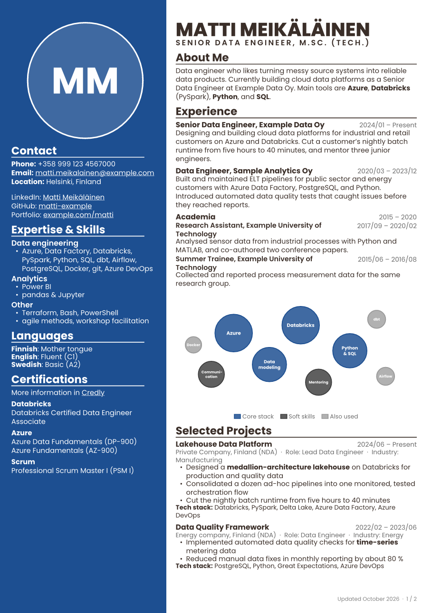
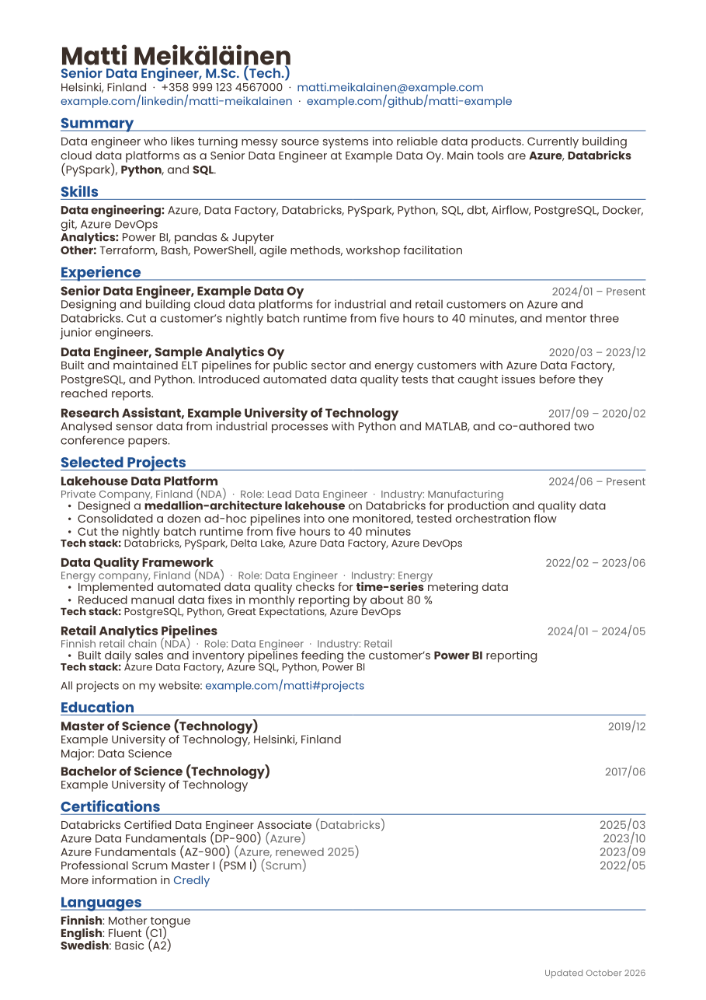
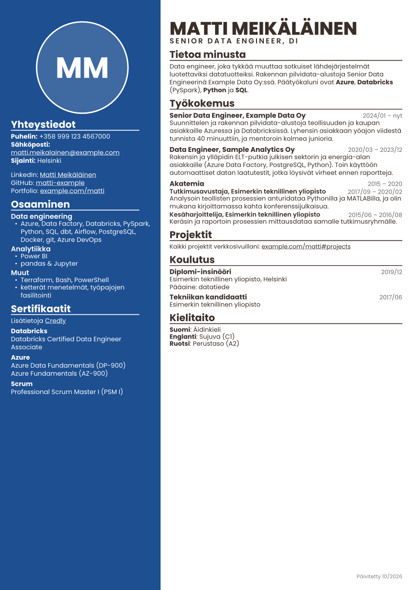
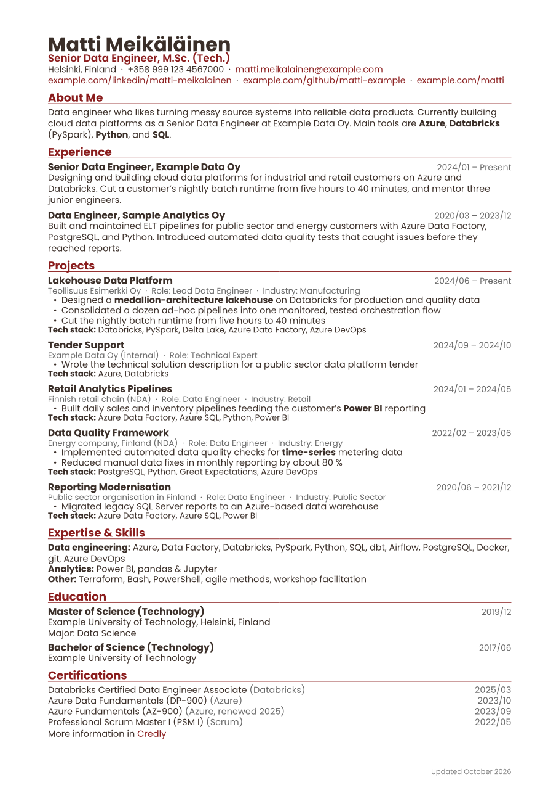

# single-source-cv

**One YAML file → your website CV page + several tailored PDF CVs, in several languages.**

Keep your whole CV in one place (`data/cv.yml`) and generate from it:

- **Website markdown** (`out/cv.md`) for GitHub Pages / Jekyll or any static site. Liquid tags pass through untouched.
- **PDF CVs** via [Typst](https://typst.app/), one per **profile** × **language**: a full CV, a one-page CV, a plain one-column **ATS-friendly** CV, a project-focused CV for tenders …
- An **internal** variant with real client names for company CV systems, while the public outputs say "Private Company (NDA)".
- A **job fit analysis** with your coding agent: drop a job ad into `jobs/<slug>/`, get a requirement-by-requirement match against your CV with gaps and suggestions, and optionally a CV tailored to that job.

The same entry can say things differently per channel (emojis on the web, a tighter paragraph in the PDF), and profiles pick sections, order, filters, and style. The example data is a fictional *Matti Meikäläinen*.

| Full (sidebar) | ATS (one column) | One page (fi) | Internal |
|---|---|---|---|
|  |  |  |  |

> This is a template repository, published as-is. It is not actively maintained. Fork, copy, and change anything; issues and PRs are welcome but support is not promised.

## Quick start

Requires Python 3.10+. Typst comes from the `typst` pip package, so no separate install is needed.

```bash
python -m venv .venv
source .venv/bin/activate # Git Bash
# Windows PowerShell: .venv\Scripts\Activate.ps1
pip install -r requirements.txt

python build.py md                   # -> out/cv.md (default language)
python build.py md --lang fi         # -> out/cv.md in Finnish
python build.py pdf --profile ats --lang en --png   # -> out/cv_ats_en.pdf + PNG previews
python build.py all --png            # markdown + every profile × language
python build.py list                 # profiles and what they are for
```

`--png` writes page previews `out/preview_*.png`. Look at them after every layout change (page count, overflow, sidebar spilling to the next page).

## Job fit analysis and tailored CVs

```
jobs/acme-senior-data-engineer/
  ad.pdf          ← you: the job ad in any format (PDF, markdown, HTML, text)
  fit.md          ← agent: how well your CV matches, gaps, missing keywords, suggestions, questions
  profile.yml     ← agent, on request: a CV profile tailored to this job
```

1. Save the ad as `jobs/<slug>/ad.pdf` (or `.md`, `.html`, `.txt`), or just paste it into the chat.
2. In [Claude Code](https://claude.com/claude-code) run `/job-fit jobs/<slug>`. Other coding agents: "analyse jobs/<slug> as described in AGENTS.md". The instructions live in `.claude/skills/job-fit/SKILL.md`, so no API key or extra dependency is needed.
3. Read `fit.md`. Every requirement gets ✅ met / 🟡 partial / ❌ missing / ❔ not in CV, with evidence pointing to items in `data/cv.yml`. The agent never invents experience and does not edit your data; wording changes are suggestions.
4. Want a tailored CV? Ask for it. The agent writes `jobs/<slug>/profile.yml` that selects and orders your projects and overrides texts such as the summary for this job (`overrides`, see AGENTS.md), then `python build.py pdf --profile jobs/<slug>/profile.yml --png` builds `out/cv_<slug>_<lang>.pdf`.

See [jobs/example-energy-lead-data-engineer/](jobs/example-energy-lead-data-engineer/) for a worked example with a fictional ad. Your own `jobs/` folders are gitignored in this template; in a private repository you can track them (see `.gitignore`).

## Privacy and AI agents

This repository is designed to be used with a coding agent (Claude Code, Codex …). That is convenient, but you should know what it means for your data, especially for internal information (`internal: true` items, `*_internal` fields such as real client names).

**What the agent sees.** Everything in `data/cv.yml` lives in one file on purpose, so an agent that reads or edits your CV reads **all** of it, including internal fields and `notes`. The job-fit skill reads internal data deliberately, as evidence of your experience (it never copies it into anything meant for an employer). Internal data also ends up in build outputs of `include_internal` profiles: `out/_resolved_<profile>_<lang>.json`, the PDF and its PNG previews, which an agent may open when it checks a layout.

**Where it goes.** Whatever the agent reads is sent to the model provider as part of the conversation and is handled under the terms of your plan and account settings (data retention, whether it may be used for training, etc.). Check them before you put information there that you are not allowed or not willing to share, for example client names covered by an NDA or your employer's policies.

**What you can and cannot enforce.** Agent instructions (AGENTS.md, the skill) are guidance, not a security boundary. Claude Code permission rules in `.claude/settings.json` (e.g. `"deny": ["Read(./data/cv.yml)"]`) block the built-in file tools and commands that name the file, but not a script that opens the file itself, and they would block the whole CV file because internal data is not in a separate file. OS-level sandboxing is the real boundary but is available only on macOS, Linux and WSL2, not on native Windows. In practice: **assume an agent working in this repository can read your internal data.**

**Your options, from simplest:**

- **Accept it consciously.** Using an agent on internal data can be fine and useful; just make the decision knowingly, within your employer's and clients' rules.
- **Keep the truly sensitive out of the file.** Store only what you are comfortable sharing with the model provider; leave the rest (e.g. real client names) in your company's own CV system.
- **Keep the agent out of the repository** when internal data is present, and edit `data/cv.yml` and build internal profiles by hand.

The same applies to `jobs/`: job ads are public, but your answers to the agent's questions end up in `notes` and in `fit.md`. And independent of AI: keep a repository with internal data private (see "Make it yours" below).

## Make it yours (after cloning)

Use **"Use this template"** on GitHub (a fresh repository without this history), or clone and re-initialise git. Then go through this list.

### 1. Privacy first

- If your data will contain anything internal (real client names, `internal: true` items), **make your repository private**. The whole point of `*_internal` fields is that they live next to the public text in the same file.
- Keep internal PDFs out of anything public. The included GitHub Action runs `build.py all --skip-internal` for this reason: workflow artifacts can be downloaded by anyone with read access.
- Your git history keeps everything you ever committed. If you later want to publish your own repo, start a new one rather than flipping a private repo with history to public.
- If you use a coding agent, it can read your internal data and sends what it reads to the model provider; see [Privacy and AI agents](#privacy-and-ai-agents) before adding anything sensitive.

### 2. Replace the data (`data/cv.yml`)

- Replace Matti with yourself. The comments at the top of the file and [AGENTS.md](AGENTS.md) explain the conventions: languages (`{en: ..., fi: ...}`), channel variants (`summary_web` / `summary_pdf`), channel-only items (`channels: [pdf]`), internal data (`client_internal`, `internal: true`), tags and dates.
- Keep the `id`s stable; profiles select items by `id` and `tags`.
- More data files: every `data/*.yml` is merged into one namespace (top-level keys must be unique), e.g. `data/publications.yml`.

### 3. Photo

- Put a square image in `assets/` and set `basics.photo: assets/photo.jpg`. Without a photo the PDF draws a circle with your initials.
- To show no photo at all, remove `photo` from the profile's `layout.sidebar` / `layout.main`.

### 4. Languages

- Supported languages are the top-level keys of `templates/labels.yml`. **The first one is the default** and the fallback for missing translations (the build prints a warning for each).
- To add e.g. Swedish, copy a block in `labels.yml`, rename it `sv:`, translate it, and use `{en: ..., sv: ...}` in the data. `build.py all` then also builds every profile in Swedish.
- To use only one language, delete the other block. Plain strings in the data work for every language.
- Date words come from the same file: `present`, and optionally `months` (web dates like "Feb 2026") and `months_long` (footer "Updated September 2026"). Without them dates are numeric.

### 5. Website template (`templates/cv.md.j2`)

- `templates/cv.md.j2` is a **generic starting point** that renders every section as plain markdown. Adapt it to your site: headings, order, front matter, badges, links. Every `templates/*.md.j2` renders to `out/<name>.md`, so you can have several pages.
- Jinja delimiters are changed to `<< var >>`, `<% block %>` and `<# comment #>` so that Jekyll's `{{ }}` / `` pass through as-is.
- The variables are the resolved data (`basics`, `experience` …) plus `labels` (UI strings of the language) and `lang`. Undefined variables are errors, so guard optional fields with `<% if x.field is defined %>`.
- Not using a website? Delete the template; `build.py md` then does nothing.

### 6. Skills bubble chart (optional, and honestly a bit fiddly)

- `skills.chart` draws the same bubble chart on the website (Chart.js) and in the PDF (Typst). It is a personal touch, not a necessity.
- **Bubbles are positioned by hand**: `x`, `y` on a 0–100 grid, `r` = radius in px of a 620 px wide chart. Nothing prevents overlaps, so expect a few rounds of edit → `--png` → look.
- Bubble sizes read as skill levels, so choose them deliberately, or leave the chart out: delete `skills.chart` and remove `skills_chart` from the profiles. The website template skips the chart when it is missing.
- `style.chart_scale` (e.g. `0.8`) shrinks it in a profile.

### 7. Profiles (`profiles/*.yml`)

- Included: `full` (sidebar, key projects, chart), `one-page`, `ats` (one column, conventional headings), `projects` (all public projects), `internal` (real client names; do not publish).
- A profile sets `layout` (`mode: sidebar | single`, section order), `filters` (`ids`, `include_tags`, `exclude_tags`, `max`), `labels` overrides (e.g. "Summary" instead of "About Me"), `style`, and optionally `publish_as` (see below). Add or delete profiles freely; `build.py all` builds whatever is there.
- `publish_as: resume.pdf` also writes the default-language PDF as `out/resume.pdf`, i.e. with the file name your website links to. Then publishing is always "copy the same files".

### 8. Look and feel

- Colours, font sizes, sidebar width etc. are `style` keys in the profile; the defaults and the full list are at the top of `templates/cv.typ`.
- The font is Poppins (in `fonts/`, SIL Open Font License). To change it, put the `.ttf` files in `fonts/` and set `style.font`.
- New PDF section: add `#let s-xxx(side) = ...` in `templates/cv.typ`, register it in the `sections` dictionary at the end, and add its heading to `labels.yml`.

### 9. Housekeeping

- Update `LICENSE` (copyright holder) if you redistribute your own version.
- `AGENTS.md` is written for AI coding agents (Claude Code, Codex …) and humans alike; keep it up to date when you change conventions, and the agent will follow them.

## Checking an ATS PDF

```bash
pip install pypdf
python -c "from pypdf import PdfReader; print('\n'.join(p.extract_text() for p in PdfReader('out/cv_ats_en.pdf').pages))"
```

The text should come out in reading order with whole words and recognisable section headings.

## License

Code: MIT (see `LICENSE`). Font: Poppins, SIL Open Font License 1.1 (see `fonts/OFL.txt`).
